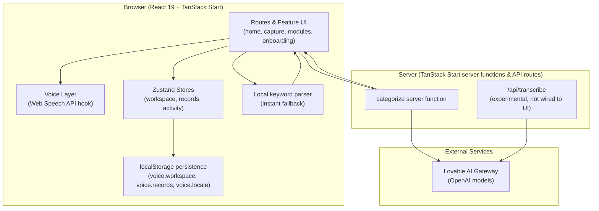

# Life OS

**Talk naturally. Stay organized.**

Life OS is a voice-first personal operations platform designed to help people manage different aspects of their everyday lives through one unified workspace.

Unlike traditional productivity applications that require users to manually organize everything, Life OS aims to understand natural user input and transform it into structured, manageable information.

The central philosophy:

- Less typing.
- Less manual organization.
- Less mental overhead.
- More natural interaction.
- One unified space for everyday life.

---

## Table of Contents

- [The Problem](#the-problem)
- [Core Features](#core-features)
- [Voice-First Interaction](#voice-first-interaction)
- [AI Integration](#ai-integration)
- [Architecture](#architecture)
- [Technology Stack](#technology-stack)
- [Installation and Local Development](#installation-and-local-development)
- [Project Structure](#project-structure)
- [Current Development Status](#current-development-status)
- [Roadmap](#roadmap)
- [Privacy and Security](#privacy-and-security)
- [Contributing](#contributing)
- [Feedback](#feedback)

---

## The Problem

People manage their lives across disconnected applications:

- Finance trackers
- Grocery lists
- Reminder applications
- Calendar applications
- Property management tools
- Notes and task managers

This creates unnecessary complexity. Life OS aims to bring these responsibilities together into one adaptive personal workspace.

---

## Core Features

Life OS is organized around **modules** — one per life domain. The category registry (`src/core/categories/registry.ts`) currently defines 12 modules:

| Module | Purpose |
| --- | --- |
| Finance | Money owed, money paid |
| Groceries | What to pick up next |
| Rent | Tenants and rent reminders |
| Property Sale | Buyers, listings, follow-ups |
| Bills | Utilities and recurring payments |
| Tasks | Small things to remember |
| Goals | What you're working toward |
| Clients | People who depend on you |
| Business | Your work, simplified |
| Study | Lessons, deadlines, notes |
| Health | Medicines, appointments, routines |
| Family | The people closest to you |

### Modular workspace architecture

The workspace is **not a fixed dashboard**. A Workspace Intelligence Engine dynamically composes each user's home screen from modular building blocks:

1. **State** — user preferences (enabled modules, order, hidden modules) persisted in a versioned store.
2. **Engine** — a pure function `composeWorkspace(prefs) → WorkspaceComposition`. No React, no I/O.
3. **Registry** — the catalog of module definitions; each module declares default widgets and quick actions.
4. **Renderer** — walks the composition and resolves each widget kind to a component through a registry, so new widget kinds plug in without touching the engine.

Users can reorder modules, hide them, and add modules back. Data-bound widget kinds render honest empty states until they have real data — no fake numbers, no demo content.

### Structured records

Every module is backed by a typed, schema-driven entity, promoting modules from static cards into mini operating environments:

- A declarative **entity registry** (`src/features/records/registry/entity.registry.ts`) declares the fields, statuses, grouping, and reminder compatibility for each module's primary entity (e.g. `finance.entry`, `groceries.item`).
- A generic **records store** (Zustand, persisted to `localStorage` under `voice.records`) powers CRUD for every module through a single repository facade.
- One set of **schema-driven components** — `RecordFormSheet` (create/edit bottom drawer), `RecordList` (grouped by status), `RecordDetail` (read view with status switching) — renders every entity. Adding a new module's entity means writing a schema entry, not new screens.
- Two generic routes power every module: list view and detail view.

---

## Voice-First Interaction

The product vision: users speak naturally, and the app does the organizing.

Example inputs the system is designed around:

- "Remind me to buy groceries."
- "Rajeev owes me 15000."
- "Buy milk and rice."
- "The Kakkanad property is vacant."

The intended workflow:

```
Voice input → Speech transcription → Transcript editing → AI categorization → User confirmation → Structured record creation
```

### Current voice implementation

- **Capture UI**: a full-screen recorder sheet (`VoiceRecorderSheet`) with recording, review, edit, re-record, and "add more" (resume) states. The mic button on the home screen opens the capture experience.
- **Recognition engine**: the browser's Web Speech API (`SpeechRecognition` / `webkitSpeechRecognition`), wrapped in `src/features/voice/useSpeechRecognition.ts`. Supported locales: `en-IN`, `ml-IN`, `hi-IN`.
- **Transcript stability**: the transcript is rebuilt from the absolute recognition result list on every event (idempotent assembly), with session isolation so stale events after Stop are ignored, a start-timeout recovery, and conservative deduplication that collapses recognizer stutter while preserving intentional repetition ("no no", "bye bye").
- **Transcript editing**: the review step presents the transcript in a standard editable text area before anything is saved.

### Known limitations

- **Browser support**: the Web Speech API is not available in all browsers. Chrome/Edge on desktop and Android work best; Safari and Firefox support is limited or absent. The app detects this and shows a "voice isn't supported" fallback with manual text entry.
- **Accuracy is browser-dependent**: recognition quality is controlled by the browser's speech service, not by the app. Accuracy varies by device, network, accent, and language.
- **Online requirement**: browser speech recognition typically requires a network connection.
- **Experimental server transcription**: a server endpoint (`src/routes/api/transcribe.ts`) that accepts WAV audio and transcribes it through the AI gateway exists, along with a `useAudioTranscription` hook, but it is **not currently wired into the UI**. The shipped path is browser recognition.

Voice recognition is functional but **not yet production-hardened** — see the [Roadmap](#roadmap).

---

## AI Integration

Life OS includes an AI categorization layer between user input and record creation. Its responsibility is deliberately limited:

- Understanding natural-language input.
- Identifying the appropriate category (module).
- Extracting relevant information (title, amount, due date, notes).
- Returning structured data with an honest confidence score.
- Presenting results for user confirmation.

**The AI never creates records autonomously.** Every AI-categorized item is shown as an editable review card; the user can adjust the category, edit fields, or discard the item before anything is saved.

### How it works

- **Contract** (`src/core/intelligence/categorization.ts`): provider-agnostic request/result types. Any AI provider can implement this shape.
- **Server provider** (`src/lib/ai/categorize.server.ts`): calls an OpenAI model through the Lovable AI Gateway. The API key is read from a server-only environment variable and never reaches the browser. Output is constrained by a strict JSON schema, so responses are always parseable; the response streams and is joined server-side.
- **Server function** (`src/lib/ai/categorize.functions.ts`): a TanStack Start server function exposing the provider to the client.
- **Client orchestration** (`src/features/capture/useCategorization.ts`): shows instant results from a deterministic local keyword parser immediately, then upgrades them with AI results when the server responds. If the AI call fails for any reason, the local parser results remain — categorization is never blocked by the network.
- **Local fallback** (`src/features/capture/parser.ts`): a deterministic keyword/regex parser that extracts module, title, amounts, and dates with no network dependency.

The contract-first design means a different model or provider can be swapped in by implementing one interface, without touching the capture UI.

---

## Architecture

Life OS is a web-first PWA built with React 19 and TanStack Start, structured so its boundaries map cleanly to a future Flutter port. The architecture is contract-first: cross-feature seams are declared as framework-agnostic TypeScript interfaces in `src/core/`, and features depend on those contracts and repository facades — never on concrete implementations directly.



### Frontend architecture

- **File-based routing** with TanStack Router (`src/routes/`): welcome (`/`), auth screens (`/login`, `/signup`), conversational onboarding (`/onboarding`), and an authenticated section (`/home`, `/capture`, `/modules/$moduleId`, `/modules/$moduleId/$recordId`).
- **Vertical-slice features** (`src/features/`): each feature (auth, voice, capture, workspace, records, onboarding, home, activity, settings) owns its UI, hooks, store, and types. Cross-feature imports go through `shared/` or repository facades, never directly into a sibling feature.
- **State management**: Zustand with `persist` middleware. Stores are versioned and include migration steps for breaking changes.
- **UI primitives**: shadcn/ui components (Radix UI) themed through Tailwind CSS v4 design tokens. Warm sand background, terracotta primary, Instrument Serif + Work Sans typography, 56px minimum touch targets.

### Backend architecture

- **Server functions** via TanStack Start `createServerFn` for app-internal server logic (AI categorization).
- **API routes** under `src/routes/api/` for HTTP endpoints (audio transcription).
- **Server-only modules** (`.server.ts` suffix) are guaranteed to stay out of the client bundle; secrets are read from `process.env` inside handlers (required for the Cloudflare Workers runtime, where env binds at request time).
- **Deployment target**: Cloudflare Workers (Nitro build, `wrangler.jsonc` with explicit entry point and asset bindings).

### Database

There is **no remote database connected yet**. All user data (workspace preferences, records, activity, locale) is persisted locally in the browser via Zustand's `persist` middleware under versioned `localStorage` keys. Repository facades (`src/features/records/repository.ts`) are the only door into the stores, so a future remote backend can be swapped in behind the same interface without UI changes.

### Authentication

Authentication is a **scaffold only**. The auth store (`src/features/auth/store.ts`) holds UI-only state, the login/signup screens exist, and the `_authenticated` route layout is in place as the future gating point — but no real session, sign-in, or access control is wired yet. All data is local to the device.

### Workspace engine, module registry, and records

See [Core Features](#core-features) — the workspace engine (`state → engine → renderer`) and the records system (`schema → repository → renderer`) are the two load-bearing pipelines of the product.

### Voice processing and AI integration

See [Voice-First Interaction](#voice-first-interaction) and [AI Integration](#ai-integration).

### Event, automation, and knowledge contracts

`src/core/` contains designed-but-mostly-dormant contract layers that define the long-term platform spine as pure TypeScript interfaces (no runtime wiring yet):

- `core/events` — typed platform event bus contracts
- `core/automation` — rule-based automation engine contracts (trigger + condition + actions)
- `core/memory` — scoped user memory namespaces
- `core/knowledge` — canonical entities, relationship graph, timeline, context model, universal search
- `core/capture` — unified capture pipeline, action model, drafts, confirmation, action history
- `core/relations` — cross-module coordination policies

These are architecture blueprints for future phases, documented in `src/ARCHITECTURE_BLUEPRINT.md` and `src/core/README.md`. They are not active runtime systems today.

### Future Flutter parity

The codebase is structured for a future Flutter port: TanStack Router routes map to a GoRouter tree, Zustand stores to Riverpod providers, i18next JSON to ARB files, and `core/` contracts port 1:1 to Dart. Feature public surfaces (component names, repository methods, store actions) are kept stable so internals can be rewritten.

---

## Technology Stack

Only technologies verified in `package.json` and the source tree:

| Technology | Role |
| --- | --- |
| React 19 | UI framework |
| TypeScript | Language (strict mode) |
| TanStack Start | Full-stack framework (SSR, server functions, API routes) |
| TanStack Router | File-based routing |
| TanStack Query | Async data primitives (available; minimal use so far) |
| Vite 7 | Build tool and dev server |
| Tailwind CSS v4 | Styling via CSS-native theme tokens |
| shadcn/ui + Radix UI | Accessible component primitives |
| Zustand | Client state management (with persistence) |
| i18next + react-i18next | Localization (English, Malayalam, Hindi) |
| Zod | Schema validation |
| React Hook Form | Form handling |
| Framer Motion | Animation |
| Lucide React | Icons |
| Sonner | Toast notifications |
| date-fns | Date utilities |
| Nitro + Wrangler | Cloudflare Workers build and deploy |
| Bun | Package manager (`bun.lock`, `bunfig.toml`) |
| Web Speech API | Browser speech recognition (voice capture) |
| Lovable AI Gateway | Server-side access to OpenAI models (categorization, transcription) |

---

## Installation and Local Development

### Prerequisites

- [Bun](https://bun.sh) (the repository uses `bun.lock` and `bunfig.toml`)
- Node.js 20+ (for tooling compatibility)

### Clone and install

```bash
git clone <repository-url>
cd <project-directory>
bun install
```

### Environment variables

The app runs locally with **no environment variables** — all data is stored in the browser.

AI features require one server-side secret, provided by the platform in the hosted environment:

| Variable | Scope | Purpose |
| --- | --- | --- |
| `LOVABLE_API_KEY` | Server only | Authenticates AI categorization and transcription calls through the Lovable AI Gateway |

If this variable is absent, AI categorization degrades gracefully to the local keyword parser, and the transcription endpoint returns a "not configured" error. Never commit real keys; no `.env` file is required for core functionality.

### Run locally

```bash
bun run dev
```

The dev server starts on port 8080.

### Build

```bash
bun run build
```

Produces `dist/client` (static assets) and `dist/server` (the server entry).

### Lint and format

```bash
bun run lint
bun run format
```

### Production deployment

The app targets Cloudflare Workers. `wrangler.jsonc` declares the entry point (`dist/server/server.js`), the asset directory (`dist/client`), and SPA fallback handling:

```bash
bun run build
npx wrangler deploy
```

---

## Project Structure

```
src/
  core/                       # Framework-agnostic platform contracts
    config/                   # App-wide constants
    types/                    # Canonical domain entities
    categories/               # Life-domain catalog (12 modules)
    voice/                    # Voice pipeline contracts
    intelligence/             # Intent + categorization contracts
    memory/                   # User memory namespace contracts
    events/                   # Platform event bus contracts
    automation/               # Automation engine contracts
    relations/                # Cross-module coordination contracts
    knowledge/                # Canonical knowledge model contracts
    capture/                  # Unified capture pipeline contracts
  features/                   # Vertical slices — one folder per product area
    auth/                     # Sign-in / sign-up UI + store (scaffold)
    voice/                    # Mic button, recorder sheet, speech recognition hook
    capture/                  # Unified capture screen, local parser, AI orchestration
    workspace/                # Workspace Intelligence Engine
      contracts/              #   ModuleDefinition, WidgetDescriptor, Composition
      registry/               #   Module catalog
      engine/                 #   composeWorkspace(prefs) — pure function
      renderer/               #   WorkspaceRenderer, ModuleCard, WidgetRenderer
      layouts/                #   Layout strategies (StackLayout)
      state/                  #   Zustand store + selectors
    records/                  # Structured entity & record management
      contracts/              #   Schema, FieldDef, RecordEntity
      registry/               #   Per-module entity schemas
      state/                  #   Records store + selectors
      components/             #   RecordFormSheet, RecordList, RecordDetail, …
      repository.ts           #   The only door into the records store
    onboarding/               # Conversational onboarding flow
    home/                     # Operational dashboard (Today, Upcoming, Activity)
    activity/                 # Activity log store
    reminders/                # Reminder contracts
    settings/                 # Language switcher
  shared/                     # Cross-feature UI primitives (Screen, TouchButton, …)
  services/                   # Side-effect adapters
    i18n/                     # i18next bootstrap + locale JSONs (en, ml, hi)
    mock-intelligence/        # Keyword-based stand-in for the AI intent layer
    notifications/            # Notification dispatcher contracts
  lib/                        # Server functions and helpers
    ai/                       # AI categorization (server provider + server function)
  routes/                     # TanStack Router file-based routes
    api/                      # HTTP API routes (transcription)
  store/                      # App-wide UI state
  hooks/                      # Generic React hooks
  ARCHITECTURE.md             # Architecture deep-dive
  ARCHITECTURE_BLUEPRINT.md   # Long-term platform blueprint
```

---

## Current Development Status

| Component | Status | Description |
| --- | --- | --- |
| Voice capture | Implemented | Browser Web Speech API with lifecycle guards, session isolation, and stutter deduplication. Browser-dependent accuracy; not production-hardened. |
| Transcript editing | Implemented | Editable text area in the review step, with re-record and "add more" flows. |
| AI categorization | Implemented | Server function through the Lovable AI Gateway with strict JSON schema output; graceful fallback to the local keyword parser. User confirmation required before any record is created. |
| Server transcription | Experimental | `/api/transcribe` endpoint and `useAudioTranscription` hook exist but are not wired into the UI. |
| Finance | Implemented | Schema-driven records (person, amounts, due date, status) with local persistence. |
| Groceries | Implemented | Schema-driven records with list grouping and quantities. |
| Bills / Rent / other modules | Implemented | All 12 modules have entity schemas, forms, lists, and detail views via the generic records system. |
| Dynamic workspaces | Implemented | Composer engine, module registry, reorder/hide/add, honest empty states. |
| Reminders | Partially implemented | Every record carries a reminder field and schemas declare reminder compatibility; no notification or scheduling engine yet. |
| Authentication | Scaffold | Login/signup UI and auth store exist; no real sessions or access gating. |
| Remote database | Not implemented | All data persists in browser `localStorage` behind repository facades. |
| Offline support | Not implemented | PWA manifest only; no service worker or offline caching. |
| Localization | Implemented | English, Malayalam, Hindi UI strings with browser detection and persistence. |
| Event/automation/knowledge layers | Contracts only | Pure TypeScript interfaces in `src/core/`; no runtime wiring. |

---

## Roadmap

These are objectives, not claims of completed functionality.

**Phase 1 — Reliability**

- Stable voice capture
- Accurate transcription
- Elimination of duplicate recognition results
- Reliable recording lifecycle
- Editable transcripts

**Phase 2 — Intelligence**

- Improved AI categorization
- Better entity extraction
- Context-aware suggestions

**Phase 3 — Automation**

- Intelligent reminders
- Cross-module workflows
- Event-driven actions

**Phase 4 — Personalization**

- Adaptive workspaces
- User preferences
- Personalized organization

---

## Privacy and Security

What is actually in place today:

- **No account system**: there is no real authentication yet, so there is no server-side user data.
- **Local-first data**: all user records, workspace preferences, and settings live in the browser's `localStorage` on the user's own device. Nothing is synced to a remote database because none is connected.
- **Server-side secrets**: the only secret (`LOVABLE_API_KEY`) is read from `process.env` inside server handlers in `.server.ts` modules, which the build guarantees never reach the client bundle. No API keys appear in client code.
- **AI data flow**: when AI categorization is used, the text the user typed or spoke is sent from the server to the AI gateway for processing. Users confirm every AI result before it is saved.
- **Microphone access**: voice capture uses the browser's permission model; audio is processed by the browser's speech service and is not recorded to disk or uploaded by the app.

Security considerations that require further implementation:

- Real authentication and access control (the `_authenticated` layout is the designated gating point).
- Server-side data protection, encryption, and retention policies once a remote database is connected.
- Caller verification on API routes before they are exposed beyond the authenticated app.

No compliance certifications or encryption-at-rest claims are made — none are implemented yet.

---

## Contributing

Life OS is being built iteratively, in controlled phases. To contribute:

1. **Explore the codebase** — start with `src/ARCHITECTURE.md` and `src/core/README.md`, then the feature folders under `src/features/`.
2. **Follow the architecture rules** — features are vertical slices; cross-feature imports go through `shared/` or repository facades; `core/` contracts stay framework-agnostic and serializable.
3. **Report bugs** — open an issue with steps to reproduce, your browser and device, and what you expected versus what happened.
4. **Suggest improvements** — open an issue describing the problem before proposing a solution.
5. **Submit contributions** — keep changes scoped, run `bun run lint` and `bun run format`, and don't add features outside the current phase without discussion.

---

## Feedback

Life OS is being developed iteratively. Early feedback is especially valuable on:

- Voice recognition problems (duplicated words, missed phrases, browser quirks)
- Incorrect categorization
- Usability issues
- Missing functionality
- Feature suggestions

---

Life OS is an ongoing experiment in making everyday life easier to manage.

We're not trying to build another task manager. We're exploring a more natural way for people to interact with their responsibilities, information, and everyday workflows.

**Talk naturally. Stay organized.**
